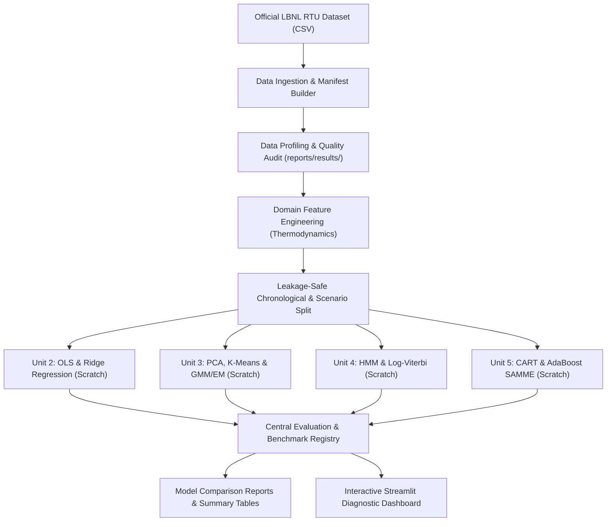

# HVAC FaultSense — System Architecture & Data Flow

## 1. High-Level System Architecture

HVAC FaultSense follows a modular, decoupled data science architecture where data ingestion, statistical profiling, feature engineering, mathematical models, evaluation metrics, and visualization interfaces remain completely independent.

## 2. Module Responsibilities

| Module Path | Primary Responsibility |
|---|---|
| `src/hvac_faultsense/data/ingestion.py` | Loads raw CSV files, enforces timestamp ordering, attaches verified scenario metadata. |
| `src/hvac_faultsense/data/metadata.py` | Scans raw folders, links files to fault categories/severities, provides Brick Schema data dictionary. |
| `src/hvac_faultsense/data/validation.py` | Calculates descriptive statistics, missingness, duplicate checks, correlations, and IQR outlier boundaries. |
| `src/hvac_faultsense/data/preprocessing.py` | Implements `StandardScalerScratch`, zero-leakage training-only fitting, and chronological data splitting. |
| `src/hvac_faultsense/features/engineering.py` | Computes physical HVAC metrics: air temperature drop $\Delta T_{air}$, condenser split $\Delta T_{cond}$, compression ratio, power ratios. |
| `src/hvac_faultsense/models/regression_scratch.py` | OLS Linear Regression implemented with NumPy gradient descent and closed-form normal equations. |
| `src/hvac_faultsense/models/ridge_scratch.py` | Ridge Regression with L2 regularization penalty and strictly unpenalized intercept. |
| `src/hvac_faultsense/models/pca_scratch.py` | PCA via covariance matrix eigendecomposition and variance ratio analysis. |
| `src/hvac_faultsense/models/kmeans_scratch.py` | K-Means clustering with k-means++ initialization and inertia tracking. |
| `src/hvac_faultsense/models/gmm_em_scratch.py` | Gaussian Mixture Model with Expectation-Maximization and BIC/AIC metrics. |
| `src/hvac_faultsense/models/hmm_viterbi_scratch.py` | Discrete Hidden Markov Model and log-space Viterbi path decoding. |
| `src/hvac_faultsense/models/cart_classifier.py` | Decision Tree classifier using Gini impurity optimization and recursive splitting. |
| `src/hvac_faultsense/models/adaboost_classifier.py` | Multi-class AdaBoost (SAMME) ensemble classifier with iterative sample re-weighting. |
| `src/hvac_faultsense/evaluation/` | Computes MAE, RMSE, R2, Accuracy, Balanced Accuracy, Precision, Recall, Macro-F1, and Confusion Matrices. |
| `src/hvac_faultsense/visualization/plots.py` | Reusable Plotly charting functions for distributions, residuals, projections, and benchmarks. |
| `src/hvac_faultsense/pipeline.py` | Master orchestrator running the end-to-end experiment pipeline and serializing artifacts. |
| `app/streamlit_app.py` | Lightweight interactive Streamlit frontend for diagnostic exploration and model review. |

## 3. Strict Boundary Rules

- **No Scikit-learn replacements:** From-scratch algorithms execute purely with NumPy. Scikit-learn is reserved exclusively for baseline checks, data splitting utilities, and reference comparisons.
- **Frontend separation:** The Streamlit dashboard does not train models on page refresh. It loads precomputed results from `reports/results/` and `experiments/` for instant, responsive rendering.

